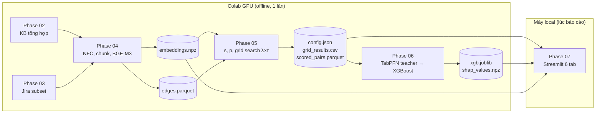

# Triển khai demo phát hiện mâu thuẫn và dự báo lỗi thời

Kế hoạch này biến tài liệu [Kế hoạch demo và dataset](https://claude.ai/artifact/5nrNXReyFt3Q3ZQSxv6Jyx) thành các bước code cụ thể. Mục tiêu là buổi báo cáo với thầy có đủ ba thứ thầy quan tâm: thuật toán chạy được, dataset có kiểm chứng chất lượng, và bảng số liệu đo trên tập test riêng.

## Kết quả mong muốn

- Một repo dùng chung cho Colab và local. Notebook chỉ `git clone` rồi gọi code trong `src/`.
- Ba nguồn dữ liệu: KB tổng hợp tiếng Việt 2 tenant (nguồn chính), Jira subset (dữ liệu thật, nhãn proxy), ViNLI (kiểm tra tín hiệu mâu thuẫn tiếng Việt).
- Layer 2: điểm `score = λ·s + (1−λ)·p`, λ và τ chọn bằng grid search trên dev theo từng tenant, báo cáo trên test.
- Layer 3: TabPFN teacher, XGBoost student, có SHAP và đo thời gian suy luận.
- App Streamlit chạy local chỉ từ file đã tính sẵn, không cần GPU và không cần mạng.

## Ràng buộc và quyết định đã chốt

- Người nghe là thầy bộ môn, không phải hội đồng.
- Không dùng Docker và PostgreSQL + pgvector trong demo. Embedding lưu bằng numpy (`.npz`), đồ thị bằng NetworkX và `scipy.sparse`. pgvector chỉ nhắc trong phần kiến trúc của báo cáo.
- Tính toán nặng (BGE-M3, TabPFN) chạy trên Colab GPU một lần, xuất ra `artifacts/`.
- Chọn λ, τ trên dev, chỉ báo cáo số liệu trên test.

## Ngoài phạm vi

- Không làm hệ thống đa người dùng, đăng nhập, hay API production.
- Không fine-tune BGE-M3 hay train NLI model riêng.
- Không xử lý toàn bộ 2,7 triệu issue Jira, chỉ 1–2 project nhỏ.

## Các phase

| # | Phase | Phụ thuộc | Ước lượng | Trạng thái |
|---|---|---|---|---|
| 01 | [Khởi tạo repo và môi trường](phase-01-repo-and-environment.md) | | 4h | pending |
| 02 | [Sinh KB tổng hợp tiếng Việt](phase-02-synthetic-vietnamese-kb.md) | 01 | 12h | pending |
| 03 | [Dataset Jira và ViNLI](phase-03-jira-and-vinli-datasets.md) | 01 | 10h | pending |
| 04 | [Layer 1: tiền xử lý và embedding](phase-04-layer1-preprocess-embedding.md) | 02, 03 | 6h | pending |
| 05 | [Layer 2: lan truyền đồ thị, fusion, calibration](phase-05-layer2-conflict-scoring.md) | 04 | 12h | pending |
| 06 | [Layer 3: dự báo lỗi thời](phase-06-layer3-obsolescence-forecast.md) | 05 | 12h | pending |
| 07 | [App Streamlit](phase-07-streamlit-demo-app.md) | 05, 06 | 10h | pending |
| 08 | [Tổng hợp kết quả và chuẩn bị báo cáo](phase-08-results-and-presentation.md) | 05, 06, 07 | 4h | pending |

Phase 02 và 03 chạy song song được (hai người khác nhau). Phase 07 có thể bắt đầu tab 1–3 ngay sau phase 05, không cần đợi phase 06.

## Luồng dữ liệu

## Tiêu chí nghiệm thu toàn dự án

1. `pytest` xanh trên local, gồm các test chống rò rỉ dữ liệu (chia tập theo nhóm, bỏ cạnh nhãn khi tính p, đặc trưng Layer 3 chỉ dùng thông tin trước mốc t).
2. Ba notebook Colab chạy "Run all" từ đầu đến cuối trên runtime mới, sinh lại được `artifacts/` với cùng seed.
3. Bảng ablation Layer 2 trên test có ba dòng (chỉ s, chỉ p, fusion) cho từng tenant, kèm λ, τ đã chọn trên dev.
4. Bảng Layer 3 trên test có ba dòng (XGBoost nhãn cứng, XGBoost + soft-label TabPFN, TabPFN) với ROC-AUC, PR-AUC, Precision@k và thời gian suy luận.
5. Báo cáo có Cohen's kappa của nhóm trên 100 cặp KB tổng hợp.
6. `streamlit run app/streamlit_app.py` mở được trong dưới 10 giây khi đã tắt mạng.

## Rủi ro chính

| Rủi ro | Ảnh hưởng | Cách xử lý |
|---|---|---|
| Cạnh đồ thị trong KB tổng hợp làm lộ nhãn (chỉ cặp mâu thuẫn mới có cạnh) | F1 của p cao giả tạo, thầy bắt lỗi | Bản diễn đạt lại cũng nằm cùng series và có REFERENCES; có nhóm mâu thuẫn ẩn không có cạnh (phase 02) |
| Bản dump Jira 5,8 GB, restore MongoDB tốn thời gian | Trễ phase 03 | Timebox 6h; nếu quá, chỉ giữ ViNLI và KB tổng hợp, ghi rõ trong báo cáo |
| TabPFN đòi chấp nhận license hoặc token Hugging Face khi tải weight | Kẹt phase 06 | Kiểm tra ngay đầu phase 06 trên Colab; ghim phiên bản `tabpfn` chạy được |
| LLM sinh tài liệu sai nhãn | Nhãn bẩn | Mâu thuẫn tạo bằng luật đổi số và điều kiện, LLM chỉ viết văn; kiểm tra kappa 100 cặp |
| Khác phiên bản thư viện giữa Colab và local | Kết quả không khớp | Ghim phiên bản trong `requirements.txt`, test so `config.json` |

## Câu hỏi còn mở

- Nhóm dùng LLM nào để sinh KB (Claude, GPT, Gemini), và ai giữ API key?
- Ai phụ trách từng phase, và hạn nộp/báo cáo là ngày nào?
- Thầy có bắt buộc dữ liệu thật không? Nếu có, phase 03 lên mức P1 thay vì timebox.
- Máy nào sẽ chạy demo lúc báo cáo?
